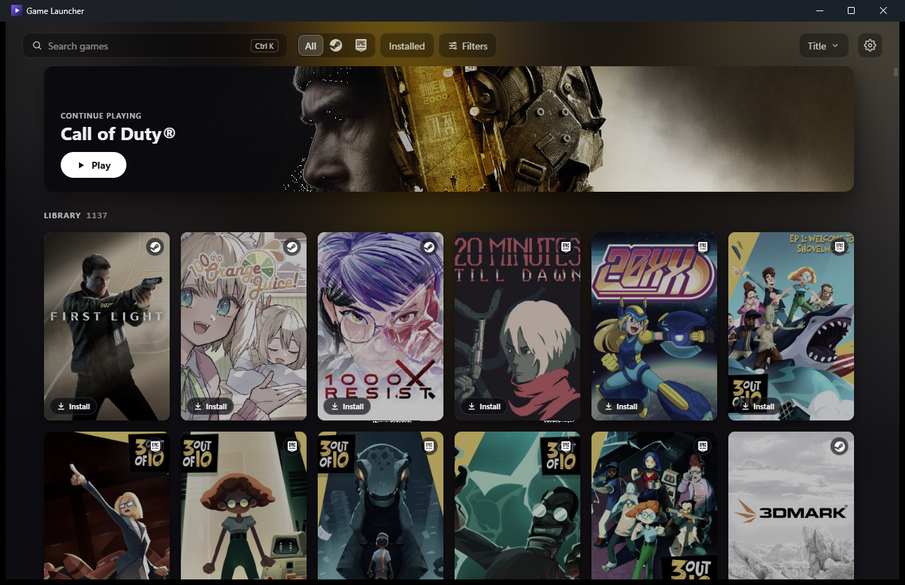

# Game Launcher

A Windows launcher that shows your Steam, Epic Games, GOG and Amazon Games libraries as one library.

## What it does

- **One library.** Steam, Epic, GOG and Amazon games share one grid. A game you own in several stores becomes one card, and you pick which store launches it.
- **Your whole Steam library**, including games you haven't installed.
- **Epic games without the Epic Games Launcher:** install with a download queue (pause, resume, reorder), updates, cloud saves, verify, repair and move installs, and import of games you already installed.
- **GOG games without GOG Galaxy:** play, install, update, verify, repair, move and uninstall them and their DLC through the same download queue, and import games you already installed. Cloud saves sync around play, and GOG's own playtime shows with the time you play here.
- **Amazon Games** in the same library. Installing and playing them comes in a later version.
- **Game pages** with the description, screenshots, playtime, last played, how long to beat, and links to the store, PCGamingWiki, SteamDB and ProtonDB.
- **Sort and filter** by store, install status, playtime and how long to beat.
- **Works offline** from its local cache.
- **Runs in the tray** if you like, starts with Windows, and shows a Windows notification when a download finishes.

## Requirements

- Windows 10 or 11
- [Steam](https://store.steampowered.com/about/), for Steam games
- [Legendary](https://github.com/derrod/legendary), for Epic games. **Settings → Accounts** installs it when you ask (a pinned release, checked against its SHA-256). Or put your own `legendary.exe` on your `PATH` or in `%LOCALAPPDATA%\Programs\legendary`.
- [gogdl](https://github.com/Heroic-Games-Launcher/heroic-gogdl), for GOG games. **Settings → Accounts** installs it the same way.
- [Nile](https://github.com/imLinguin/nile), for Amazon games. **Settings → Accounts** installs it the same way.
- Optional, for how long to beat: a free Twitch developer application (see below)

## Install

Download the `x64-setup.exe` file from the [latest release](https://github.com/TheBiemGamer/game-launcher/releases/latest) and run it. It installs for your Windows user only, so it doesn't ask for admin rights.

The app isn't code-signed, so Windows SmartScreen may warn you the first time. Click **More info**, then **Run anyway**.

Updates download and install themselves. To build it yourself, see [DEVELOPMENT.md](DEVELOPMENT.md).

## Getting started

Open **Settings** with the gear button at the top right.

- **Steam:** click **Log in** next to Steam and sign in with your password, or scan the QR code with the Steam mobile app.
- **Epic Games:** click **Log in** next to Epic Games and sign in on the Epic page that opens. Its **Options** hold the install folder, cloud save sync, importing existing installs and syncing with the Epic Games Launcher.
- **GOG:** click **Log in** next to GOG and sign in on the GOG page that opens. Its **Options** hold the install folder, cloud saves and importing existing installs.
- **Amazon Games:** click **Log in** next to Amazon Games and sign in on the Amazon page that opens. Its **Options** hold the install folder.
- **How long to beat:** create an application in the [Twitch developer console](https://dev.twitch.tv/console/apps), then paste its client ID and secret under **Extra metadata**.

## Why is a game shown twice?

An Epic, GOG or Amazon copy joins a Steam game only when [GOG GamesDB](https://gamesdb.gog.com) links it to that exact Steam app, which you own. Games with the same title but no such link stay separate cards, and so do Epic, GOG and Amazon copies of a game you don't own on Steam.

## Your data

- Your library, settings, play history and cached art live in `%LOCALAPPDATA%\launcher\`. **Settings → Storage** clears the cache.
- Your Steam login token and IGDB secret are kept only in Windows Credential Manager. Your Steam password and Steam Guard codes are never stored. Legendary keeps the Epic login in its own folder, gogdl keeps the GOG login in `%LOCALAPPDATA%\launcher\data\gog`, and Nile keeps the Amazon login in `%LOCALAPPDATA%\launcher\data\amazon`.

## Services it connects to

- **Steam:** login and the Steam network, for owned games and download sizes
- **Epic Games:** through Legendary
- **GOG:** login, and GOG's API for your owned games, their titles and art, your account name, new game builds, cloud save settings and the playtime GOG counted; downloads and cloud saves through gogdl. Play sessions timed here are never sent to GOG.
- **Amazon Games:** login and your owned games, through Nile
- **GOG GamesDB:** links Epic, GOG and Amazon games to their Steam versions, and has the GOG and Amazon games' covers
- **IGDB (via Twitch):** how long to beat, only if you add credentials
- **SteamGridDB:** covers for games you add yourself, only if you add an API key
- **Store image servers** (Steam, Epic, GOG, Amazon): cover art and screenshots
- **GitHub:** downloads a store tool's official release when you ask Settings to install it

Third-party tools (GPL-3.0, downloaded from their official releases only when you ask): [Legendary](https://github.com/derrod/legendary) for Epic, [gogdl](https://github.com/Heroic-Games-Launcher/heroic-gogdl) for GOG, [Nile](https://github.com/imLinguin/nile) for Amazon.

Some of these connections are unofficial and can break when a store changes its API. When one fails, a dot appears on the Settings button.

## License

[GPL-3.0](LICENSE)
